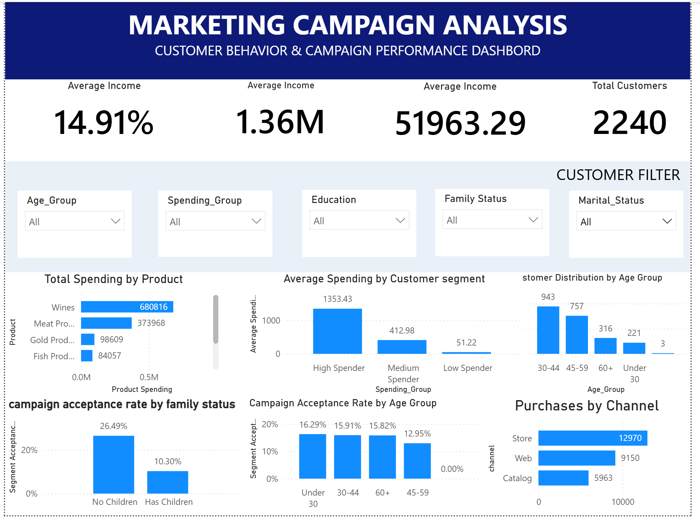

# 📊 Marketing Campaign Analysis

An end-to-end data analysis project focused on customer segmentation, purchasing behavior, product performance, and marketing campaign effectiveness.

The project combines Python, SQL, SQLite, and Power BI to transform raw customer data into actionable business insights and an interactive dashboard.

## 🎯 Project Overview

The main objective of this project is to understand customer behavior, identify valuable customer segments, analyze purchasing patterns, and evaluate marketing campaign acceptance.

The analysis covers 2,240 customers and includes data cleaning, feature engineering, exploratory data analysis, SQL analysis, business insights, and interactive reporting.

## 🛠️ Tools & Technologies

- **Python** – Data analysis and processing
- **Pandas & NumPy** – Data cleaning and manipulation
- **Matplotlib & Seaborn** – Data visualization
- **SQL & SQLite** – Data querying and analysis
- **SQLAlchemy** – Database connection
- **Power BI** – Interactive dashboard development
- **Jupyter Notebook** – Analysis documentation

## 🔄 Project Workflow

1. Data Understanding
2. Data Cleaning
3. Feature Engineering
4. Exploratory Data Analysis (EDA)
5. SQL Analysis with SQLite
6. Business Insights & Recommendations
7. Power BI Dashboard Development

## 💡Key Business Insights

👥**Customer Segmentation**

- High Spenders represent approximately one-third of customers.
- They account for approximately 74.5% of total customer spending.
- Their average spending is approximately 1,353.

🛍️**Product Performance**

- Wines and Meat Products are the top-performing product categories.
- Together, they account for approximately 77.7% of total product spending.

🏬**Purchase Channels**

- Physical stores are the most frequently used purchasing channel.
- Web purchases rank second, followed by catalog purchases.

📣**Marketing Campaign Performance**

- The last marketing campaign achieved the highest acceptance rate at 14.91%.
- Campaign 2 had the lowest acceptance rate at 1.34%.

🧑‍🤝‍🧑**Customer Behavior**

- Customers without children have a higher average spending than customers with children.
- Customer income has a strong positive correlation with total spending (0.79).

⭐**Valuable Customer Segment**

- 866 customers were identified as having both above-average income and above-average spending.
- This segment has an average campaign acceptance rate of 21.82%.

## 📊 Power BI Dashboard

The interactive dashboard includes:

- Total Customers
- Average Income
- Total Spending
- Campaign Acceptance Rate
- Customer distribution by age group
- Average spending by customer segment
- Product spending by category
- Purchases by channel
- Campaign acceptance by age group
- Campaign acceptance by family status

Interactive filters allow users to explore the results by age group, spending group, education, marital status, and family status.

## 🖼️ Dashboard Preview


## 📁 Repository Structure
```
marketing-campaign-analysis/
│
├── data/
│
├── notebooks/
│   └── marketing_campaign_analysis.ipynb
│
├── sql/
│
├── powerbi/
│   └── marketing_campaign_dashboard.pbix
│
├── reports/
│   ├── marketing_campaign_dashboard.pdf
│   └── marketing_campaign_dashboard.png
│
├── README.md
├── requirements.txt
└── .gitignore
```
## 🚀 How to Run

1. Clone this repository:
   ```
   git clone https://github.com/mobo2r-ali/marketing-campaign-analysis.git
    ```
2. Navigate to the project directory:
    ``` 
   cd marketing-campaign-analysis
    ```
3. Install the required libraries:
   ```
   pip install -r requirements.txt
    ```
4. Download the dataset from Kaggle and place the CSV file inside the "data/" directory.

5. Open the Jupyter Notebook and run the analysis:
   ```
   jupyter notebook
    ```
6. Open the Power BI dashboard using Power BI Desktop.

## 📚 Dataset

**Customer Personality Analysis**

Source: "Kaggle – Customer Personality Analysis" (https://www.kaggle.com/datasets/imakash3011/customer-personality-analysis)

The dataset contains customer demographic information, purchasing behavior, product spending, and marketing campaign responses.

## 👨‍💻 Author

***Ali Razavi***

**Aspiring Data Analyst | Python | SQL | Data Visualization | Power BI**

- GitHub: "mobo2r-ali" (https://github.com/mobo2r-ali)